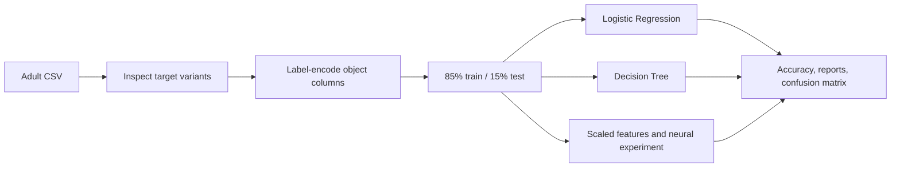

<div align="center">

# Adult Income Analysis

### Explore census features and learn from classification experiments.

**Census Data · Classification · Neural Network Experiment**


[Overview](#overview) · [Workflow](#workflow) · [Results](#results) · [Run Locally](#run-locally)


</div>

## Overview

A notebook study of demographic and work-related features in the **Adult Census Income dataset**. It explores categorical encoding, train/test splitting, Logistic Regression, a Decision Tree, and a small neural network.

The underlying question is whether census attributes can distinguish income categories. The committed experiment also exposes an important data-quality lesson: differently formatted target labels must be normalized before a binary classification task is evaluated.

<details>
<summary><strong>نبذة بالعربية</strong></summary>

تجربة تصنيف على بيانات الدخل السكاني باستخدام الانحدار اللوجستي وشجرة القرار وشبكة عصبية. يتضمن التوثيق النتائج المحفوظة فعليًا، ويوضّح الحاجة إلى توحيد تسميات الدخل قبل اعتبار المسألة تصنيفًا ثنائيًا.

</details>

## Data

The included [adult.csv](adult.csv) contains **48,842 records** in the saved notebook output, with fields such as age, work class, education, occupation, marital status, hours per week, capital gain/loss, and income.

The target appears in four string forms:

| Raw Label | Recorded Count |
|---|---:|
| `<=50K` | 24,720 |
| `<=50K.` | 12,435 |
| `>50K` | 7,841 |
| `>50K.` | 3,846 |

LabelEncoder treats these as four separate classes. The intended two-class task requires whitespace/punctuation normalization first.

## Workflow



The notebook creates a one-hot matrix as an experiment, but the split and classical models use the label-encoded `x` table. A scaler is created; the classical models shown are fitted on the unscaled training table.

## Results

| Saved Experiment | Recorded Accuracy | Interpretation |
|---|---:|---|
| Logistic Regression | 52.90% | Four-label target; saved convergence warning |
| Decision Tree, depth 10 | 58.13% | Four-label target |
| Neural network | 50.47% | Invalid experiment setup: binary output with four encoded labels; training loss is NaN |

These figures describe the committed outputs, not a claim of 80–85% accuracy. A Random Forest is not trained in this notebook.

The preview is the original Logistic Regression confusion matrix. Read class-specific precision and recall alongside accuracy: the saved model rarely or never predicts some of the encoded labels.

## Model Design

The neural experiment uses dense layers with **64 → 32 → 1** units, ReLU hidden activations, a sigmoid output, SGD, binary cross-entropy, ten epochs, and batches of 32.

Before interpreting that model, normalize the target to two labels, inspect missing-value tokens, and train/evaluate with matching loss and output dimensions. The current NaN loss means its reported accuracy should not be treated as a valid model result.

## Improving the Experiment

- Normalize target strings before encoding.
- Treat `?` and other missing-value markers explicitly.
- Fit preprocessing on training data only.
- Use a reproducible, stratified split and a majority-class baseline.
- One-hot encode nominal features instead of implying an arbitrary order.
- Compare scaled Logistic Regression with a valid binary neural model.
- Investigate subgroup performance; this historical dataset does not establish causal effects of demographic attributes.

## Run Locally

Clone the repository and create an isolated Python environment:

```bash
git clone https://github.com/ismailhalawa-ctrl/Adult-Income-Analysis.git
cd Adult-Income-Analysis
python -m venv .venv
```

```powershell
# Windows PowerShell
.\.venv\Scripts\Activate.ps1
```

```bash
# macOS / Linux
source .venv/bin/activate
```

```bash
python -m pip install numpy pandas matplotlib seaborn scikit-learn tensorflow jupyterlab
jupyter lab "Adult Income Analysis.ipynb"
```

Replace `/content/adult.csv` with `adult.csv`. Start by reviewing the raw target value counts; the included data needs target normalization before a meaningful binary-model rerun.

Run cells from top to bottom in one kernel. The repository does not pin package versions; saved outputs reflect the original environment and are not a fresh benchmark. If a library API has changed, adapt that cell before continuing.

## Repository Guide

| File | Purpose |
|---|---|
| [Adult Income Analysis.ipynb](Adult%20Income%20Analysis.ipynb) | Analysis source, narrative, and recorded outputs |
| [adult.csv](adult.csv) | Included census dataset |
| `README.md` | Project overview and reproduction guide |

The preview is an original saved notebook output, hosted in the [shared portfolio figure gallery](https://github.com/ismailhalawa-ctrl/Data-Analysis-Projects/tree/main/docs/figures). It has not been regenerated or used as evidence of a new experiment.

## Extending the Work

Keep preprocessing and model selection reproducible, record package versions, and validate changes against an appropriate baseline. The repository is a notebook study; it does not include a deployed prediction API or an automated regression suite.

---

Created by **[Ismail Halawa](https://github.com/ismailhalawa-ctrl)** · [Explore the portfolio](https://github.com/ismailhalawa-ctrl?tab=repositories)

